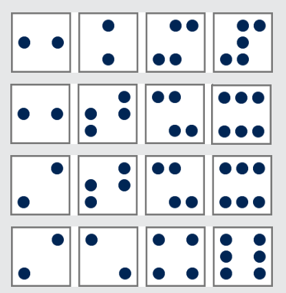

Antwort D ist richtig: Die Befehlsfolgen erzeugen das Punktemuster in den folgenden Schritten (für jede Antwort A bis D eine Zeile):

## Das ist Informatik!

Die Ausdrucksmöglichkeiten unserer formalen Punktemustersprache sind sehr begrenzt. Keine Wiederholungsschleifen. Keine bedingten Verzweigungen. Keine Parameter. Keine Deklaration neuer Datenobjekte. „Universell“ (Turing-Vollständigkeit) ist die Punktemustersprache sicher nicht. Man kann nur ihre vier Befehle (draw-1, draw-2a, draw-2b, turn90) beliebig aneinander reihen und dadurch eine Matrix von drei mal drei Punkten verändern. Aber man kann mit ihr sein Programmierdenken trainieren: Wer kann für ein gegebenes Punktemuster das kürzeste Punkteherstellungsprogramm schreiben?
