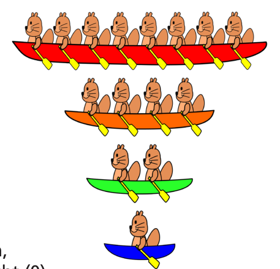

Einige Biber möchten an einem Ruderturnier teilnehmen. Sie haben vier Boote, eins für jede Bootsklasse: eins für acht Biber, eins für vier Biber, eins für zwei Biber und eins für einen einzelnen Biber.

Die Regeln des Ruderturniers legen fest, dass jeder Biber nur in einer Bootsklasse teilnehmen darf.

Der Trainer der Biber muss nun für jedes Boot aufschreiben, ob seine Biber in dieser Bootsklasse teilnehmen (1) oder nicht (0).

Er fängt mit dem größten Boot an, dann mit dem zweitgrößten, usw. Wenn zum Beispiel zehn Biber teilnehmen möchten, würde er 1010 aufschreiben.

Diesmal sind es dreizehn Biber, die teilnehmen möchten.

**Was muss der Trainer aufschreiben?**
