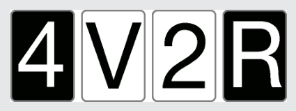

Die E-Karte muss umgedreht werden, um zu prüfen, ob auf der Rückseite eine gerade Zahl ist. Wäre sie ungerade, hätte Aristo die Unwahrheit gesagt. Die V-Karte muss nicht umgedreht werden. Über Konsonanten hat Aristo nichts gesagt, also keine Wahrheit und auch keine Unwahrheit. Die 2-Karte muss nicht umgedreht werden. Falls auf der Rückseite ein Konsonant wäre, hätte Aristo keine Unwahrheit gesagt. Falls dort ein Vokal wäre, hätte er die Wahrheit gesagt. Die 7-Karte muss umgedreht werden. Wäre auf der Rückseite ein Vokal, hätte Aristo die Unwahrheit gesagt.

## Das ist Informatik!

Es ist gar nicht schwer, einen Computer denken zu lassen. Vor allem wenn es um das Denken in klassisch-logischen Implikationen geht. Fast jede Programmiersprache bietet dazu als Basis das Konstrukt (IF a THEN b) an. In einigen Programmiersprachen kann man sogar einen weit verbreiteten menschlichen logischen Denkfehler programmieren: (IF (IF a THEN b) THEN (IF b THEN a)) ist unlogisch und nicht wahr!
