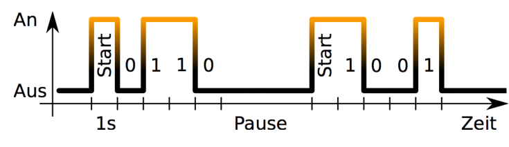
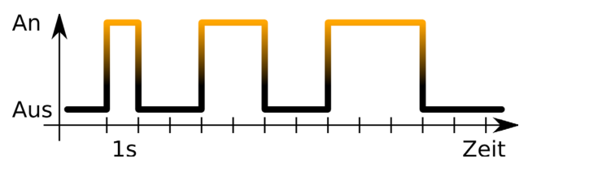

Alice und Bob möchten nachts mit ihren Taschenlampen Nachrichten übertragen. Sie senden sich Blöcke von vier Ziffern. Die Ziffern sind 0 oder 1. Zum Start eines Ziffernblocks schalten sie die Taschenlampe für eine Sekunde ein. Danach kommen die vier Ziffern im Sekundentakt. Taschenlampe an bedeutet 1, Taschenlampe aus bedeutet 0. Bis zum nächsten Block kommt dann eine Pause von mindestens einer Sekunde, mit Taschenlampe aus.

Das Beispiel zeigt die Übertragung der Ziffernblöcke 0110 und 1001:

**Welche Ziffernblöcke werden hier übertragen?**
