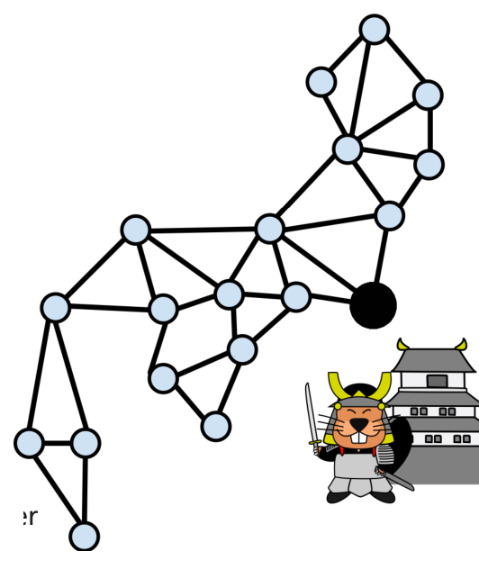

Vor langer Zeit hatten die Samurai in Japan ein Netz von Signalstationen aufgebaut. Um im Notfall das ganze Land zu alarmieren, konnten auf den Stationen Signalfeuer entzündet werden. Im Bild sind die Signalstationen als Kreise gezeichnet. Stationen, die mit einer Linie verbunden sind, sind Nachbarn.

Wird auf einer Station ein Signalfeuer entzündet, sehen die Nachbarn das Feuer nach einer Minute und zünden selbst sofort ein Signalfeuer an. Nach einer weiteren Minute zünden also auch die Nachbarn der Nachbarn ein Signalfeuer an. Und so geht es weiter, bis auf allen Stationen ein Signalfeuer entzündet ist. Eines Tages wird auf der Station im Hauptquartier (der größere schwarze Kreis) ein Signalfeuer entzündet.

**Nach wie vielen Minuten ist auf allen Signalstationen ein Signalfeuer entzündet?**
