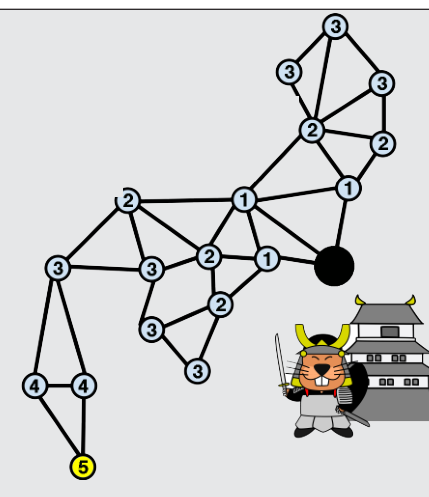

Antwort B ist richtig: Auf allen Signalstationen, die nach einer Minute das Signalfeuer des Hauptquartiers sehen können, wird auch das Signalfeuer entzündet. Auf allen Signalstationen, die diese Signalfeuer nach zwei Minuten sehen können, wird auch das Signalfeuer entzündet. Auf allen Signalstationen, die diese Signalfeuer nach drei Minuten sehen können, wird auch das Signalfeuer entzündet. Und so weiter.

## Das ist Informatik!

Die Signalstationen und ihre Sichtverbindungen sind als Graph dargestellt. Die Datenstruktur Graph wird in der Informatik häufig verwendet, um Karteninformation zu abstrahieren. Ein gutes Beispiel für eine starke Abstraktion sind die U-Bahn-Netzkarten. In unserem besonderen Fall ist die zeitliche Entfernung zwischen zwei benachbarten Signalstationen immer gleich. Die Lösung war es, für alle Signalstationen die kürzeste Entfernung zum Hauptquartier zu berechnen und von diesen kürzesten Entfernungen die längste auszuwählen. Das kann zum Beispiel mit Hilfe einer „Breitensuche“ im Graph gemacht werden.
