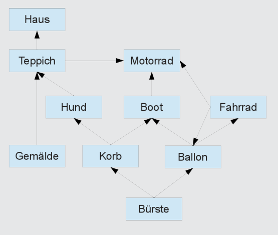

Benny tauscht nacheinander: bei Bert die Bürste gegen einen Korb, bei Gustav den Korb gegen einen Hund, bei Jeanine den Hund gegen einen Teppich und bei Norbert den Teppich gegen ein Haus.

## Das ist Informatik!

Der ganze Tauschhandel kann als „gerichteter Graph“ betrachtet werden. Die Knoten des Graphen, hier als Kästchen dargestellt, sind die Tauschobjekte. Die Kanten des Graphen, hier als Pfeile dargestellt, sind die Tauschangebote. Ein Weg im Graphen, den Pfeilen folgend von einem Knoten zu einem anderen Knoten, zeigt, wie man mehrmalig tauschen kann. Nicht jeder Knoten ist von jedem anderen Knoten aus über einen Weg „erreichbar“, man kann also nicht jedes Tauschobjekt gegen jedes andere eintauschen.
