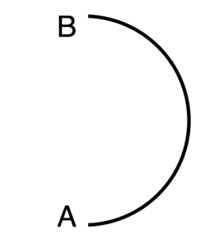
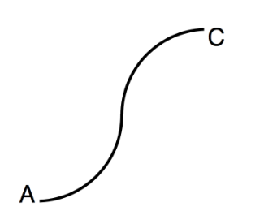

Du hast einen kleinen Roboter, der kann diese Befehle ausführen:

| Befehl | Bedeutung |
|---|---|
| V | einen Schritt vorwärts gehen |
| L (Winkel) | Linksdrehung, die Größe des Winkels steht in den Klammern |
| R (Winkel) | Rechtsdrehung, die Größe des Winkels steht in den Klammern |

Zu Beginn steht der kleine Roboter immer am Punkt A. Er ist nach rechts ausgerichtet und wartet auf sein Programm. Soll der kleine Roboter mehrere Befehle hintereinander ausführen, werden sie mit + aneinander gereiht. Zum Beispiel bedeutet das Programm V+L(20)+V+R(2), der Roboter soll einen Schritt vorwärts gehen, sich dann 20° nach links drehen, dann einen Schritt vorwärts gehen und sich abschließend 2° nach rechts drehen. Soll der kleine Roboter etwas mehrmals tun, wird das mit * ausgedrückt. Zum Beispiel bedeutet das Programm 180*(V+L(1)), dass der Roboter 180 mal nacheinander die zwei Befehle V und L(1) ausführen soll. Das Bild zeigt ungefähr seinen Weg von A nach B:

**Mit welchem Programm geht der kleine Roboter ungefähr diesen Weg von A nach C?**
