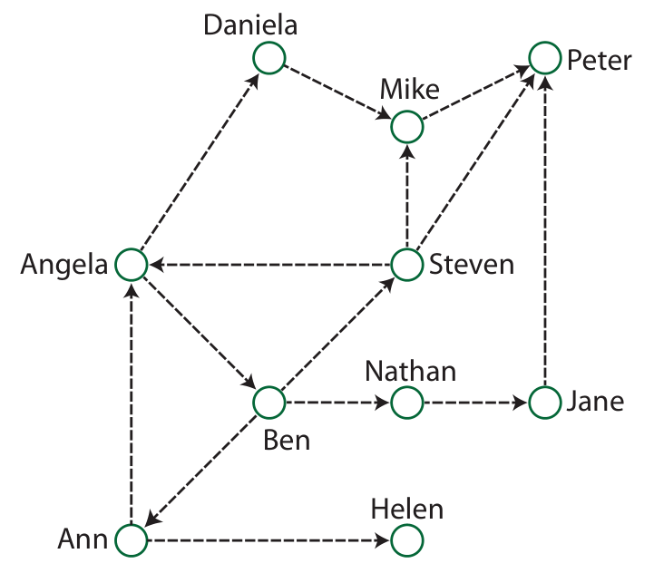

Die Biber in der Schule reden gerne miteinander und lieben es, Neuigkeiten zu verbreiten.

Das Bild zeigt, wer Neuigkeiten an wen weitergibt. Zum Beispiel erzählt Steven alles seinen Freunden Angela, Mike und Peter.

Heute brachte Ann eine interessante Neuigkeit mit in die Schule, die sich rasch verbreitete. Während der Mittagspause saßen Helen, Peter, Steven und Jane zusammen und stellten fest, dass zwar Helen und Peter von der Neuigkeit gehört hatten, nicht aber Steven und Jane. Offenbar fehlte heute jemand in der Schule, was die normale Verbreitung von Neuigkeiten verhindert hat.

**Wer fehlte heute in der Schule?**
