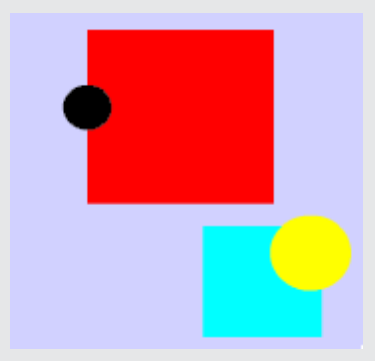

Antwort A ist richtig:

In den Anweisungen der Druckmaschine wird zu Beginn ein Kreis zufällig ausgewählt und später nur dessen Größe noch geändert. Alle Kreise eines Papierbogens müssen also die gleiche Farbe haben. Papierbogen A enthält aber zwei Kreise unterschiedlicher Farbe. Außerdem druckt die Maschine die Kreise und Quadrate in dieser Folge: Kreis – Quadrat – Kreis – Quadrat. Bei Papierbogen A sind aber beide Kreise auf je ein Quadrat gedruckt; das kann die Druckmaschine nicht.

Das Programm sorgt dafür, dass gleich viele Quadrate und Kreise gedruckt werden. Dennoch kann Papierbogen B entstehen, wenn zufälligerweise die Quadrate genau auf die Kreise gedruckt wurden. Es kann auch sein, dass die Kreise zufälligerweise die gleiche Farbe haben wie der Hintergrund.

Auf den Papierbögen C und D sind jeweils gleich viele Kreise und Quadrate. Die Kreise haben auf jedem Papierbogen nur eine Farbe und kommen in höchstens zwei unterschiedlichen Größen vor. Diese Papierbögen können von der Druckmaschine gedruckt worden sein.

## Das ist Informatik!

Einer der zentralen Begriffe der Informatik ist der des Algorithmus: eine strukturierte Abfolge von Anweisungen, die eine Maschine ausführen soll. Die Anweisungen der Druckmaschine sind ein Algorithmus. Seine Struktur erhält er durch die Reihenfolge der einzelnen Anweisungen und die Wiederholungsanweisung („Wiederhole den folgenden Block …“).

Algorithmen, die mit zufälligen Elementen arbeiten, nennt die Informatik „randomisiert“. Randomisierte Algorithmen liefern nicht immer gute Ergebnisse (Papierbogen B ist ein Beispiel dafür), aber im Durchschnitt. Randomisierte Algorithmen sind oft einfach zu verstehen und zu programmieren und liefern oft gute Ergebnisse für besonders schwierige Probleme. Die Informatik arbeitet daran, die Auswirkungen des Zufalls in solchen Algorithmen zu verstehen und zu kontrollieren. Schließlich wollen wir von einem Programm wissen, wie gut seine Ergebnisse sind.
