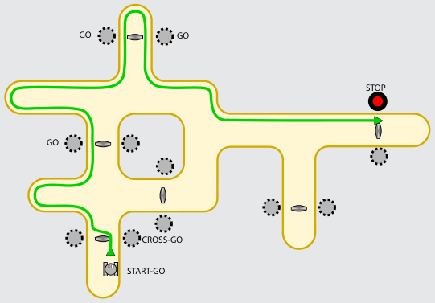

Der Roboter bleibt rechts am oberen Fahrbahnrand stehen. Das Bild zeigt den Verlauf der Fahrt.

## Das ist Informatik!

Fahrroboter (also automatische Fahrzeuge ohne Fahrer) findet man zum Beispiel auf Flughäfen und in Fabriken. Diese Maschinen werden durch Programme gesteuert. Im einfachsten Fall ist ein Programm eine simple Folge von Anweisungen – wie in dieser Biber-Aufgabe. Bei echten Fahrrobotern können die Programme aber deutlich komplizierter sein. In der Informatik arbeiten viele Leute an Programmen für Roboter: Fahrroboter, Konstruktionsroboter, Medizinroboter, Fußballroboter, Flugroboter und so weiter. Das Verhalten von Robotern wirkt sich oft auch auf deren Umwelt und damit auch auf Menschen aus. Programme für Roboter müssen deshalb besonders verlässlich sein.
