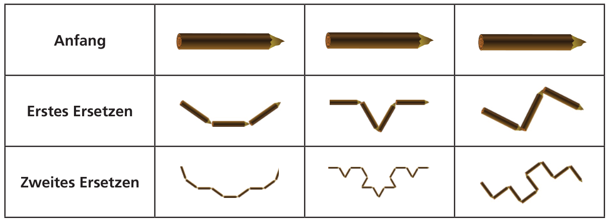
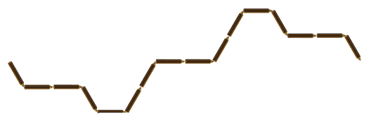

Wenn die Biber Baumstämme zerteilen, legen sie die Teile auf eine besonders kunstvolle Art aus. Am Anfang liegt nur ein einfacher großer Baumstamm da. Der wird dann auf eine bestimmte Art durch kürzere Baumstämme ersetzt. Diese kürzeren Baumstämme werden wiederum auf dieselbe Art durch noch kürzere Baumstämme ersetzt.

Hier sieht man drei verschiedene Beispiele:

Wenn es nach dem zweiten Ersetzen so aussieht:

**Wie sah es nach dem ersten Ersetzen aus?**
