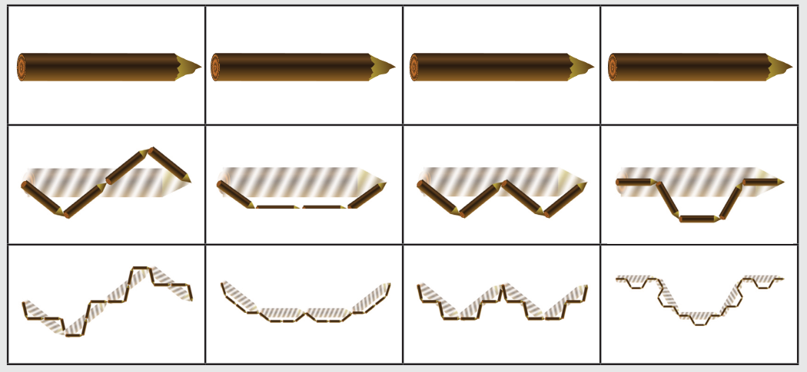

Antwort A ist richtig. Bei den anderen Antworten würde es nach dem ersten Ersetzen jeweils anders aussehen:

## Das ist Informatik!

Die Ergebnisse von Ersetzungsfolgen dieser Art werden Fraktale genannt. Die besondere Eigenschaft von Fraktalen ist es, dass sie sich auf den verschiedenen Größenstufen selbstähnlich sind.

Theoretisch entsteht ein Fraktal erst durch unendlich viele Ersetzungen. In der Praxis der Informatik kann man so lange nicht warten und bricht daher die Ersetzungsfolge ab, wenn ein genügend brauchbares Zwischenergebnis erreicht ist.

Das zweite Beispiel in dieser Biber-Aufgabe ist ein besonders bekanntes Fraktal; es heißt nach seinem Erfinder Koch-Kurve.
