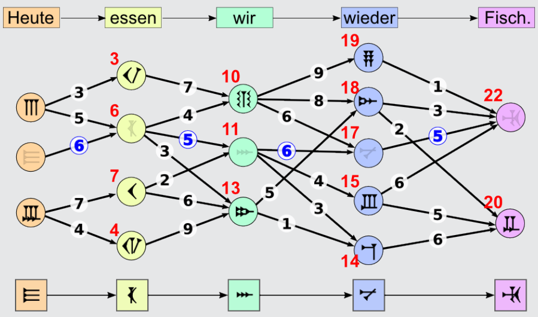

Für diese Übersetzung ist die Summe der zugehörigen Passzahlen (blau gefärbt): 6 + 5 + 6 + 5 = 22. Dies ist die größtmögliche Summe.

Wie kann man die beste Übersetzung schnell herausfinden, ohne alle Möglichkeiten auszuprobieren? Eine gute Methode ist, von links nach rechts für jedes Zeichen zu bestimmen, wie die größte Passzahlsumme bis zu diesem Zeichen lautet. Dazu muss man nur die vorher bestimmten besten Wege der Vorgängerzeichen berücksichtigen – und nicht alle Wege. Das Bild zeigt für jedes Zeichen in Rot die so ermittelten Werte. Ganz rechts sieht man, dass 22 wirklich die insgesamt größte Summe ist. Wenn man sich gemerkt hat, von wo aus man jeweils zur besten Summe gekommen ist, kann man vom besten Gesamtergebnis aus (also 22) rückwärts (entlang der blauen Zahlen) die beste Übersetzung bestimmen.

Die hier verwendete Methode, eine optimale Möglichkeit von links nach rechts schrittweise zu konstruieren, heißt „Dynamische Programmierung“.

## Das ist Informatik!

Das Internet bietet die technischen Möglichkeiten dafür, dass wir uns leicht mit anderen Menschen auf der ganzen Welt austauschen können. Doch die meisten Menschen sprechen eine andere Sprache. Da sind Informatiksysteme hilfreich, die Texte oder sogar gesprochene Sprache automatisch übersetzen können. Moderne Übersetzungssysteme berücksichtigen – wie Betty –, welche Wörter in der Zielsprache der Übersetzung häufig gemeinsam vorkommen. Solche Wortmuster finden die Systeme, indem sie möglichst viele Texte statistisch untersuchen. Die Grammatik der Sprachen wird hingegen nicht so genau beachtet. Das würde die Menge der zu verarbeitenden Informationen zu sehr in die Höhe treiben und die Übersetzung verlangsamen. Deshalb fallen automatische Übersetzungen oft etwas merkwürdig aus.
