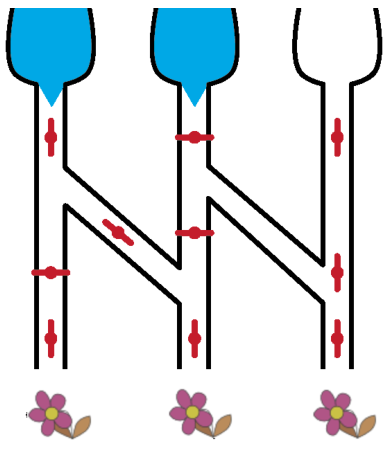

Ein Ventil lässt Wasser nur durch, wenn es offen ist.

| Ventil zu | Ventil offen |
|---|---|
|  |  |
| Wenn das Ventil zu ist, fließt kein Wasser. | Wenn das Ventil offen ist, fließt Wasser durch. |

**Welche der drei durstigen Blumen bekommen Wasser bei dieser Stellung der Ventile? Wähle alle diese Blumen aus.**
