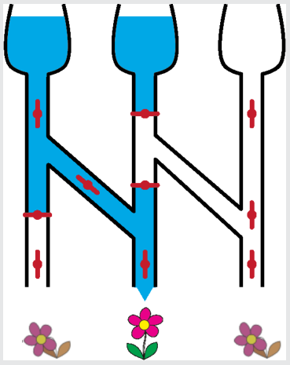

Nur die mittlere Blume bekommt Wasser bei dieser Stellung der Ventile.

## Das ist Informatik!

Für die Informatik ist unser Bewässerungssystem eine Schaltung. Die Ventile sind die Schalter – mit den zwei Stellungen „auf“ und „zu“. Entsprechend den Eingabetrichtern und den Schalterstellungen bewegen sich die Informationen „Wasser fließt“ und „Wasser fließt nicht“ durch die Schaltung – bis hin zu den Blumen. Elektronik-Geräte enthalten elektronische Schaltungen, durch die Elektrizität fließt. Bei Schaltungen mit Glasfasern fließen die Informationen als Laserlicht. Es gibt robotische Geräte, die in Umgebungen arbeiten müssen, in denen elektronische Schaltungen schnell kaputt gehen: Starke Magnetfelder, hohe Feuchtigkeit, extreme Temperaturen. Solche Robotik kann schon mal robuste Schaltungen enthalten, in denen Hydrauliköl oder Pressluft fließen.
