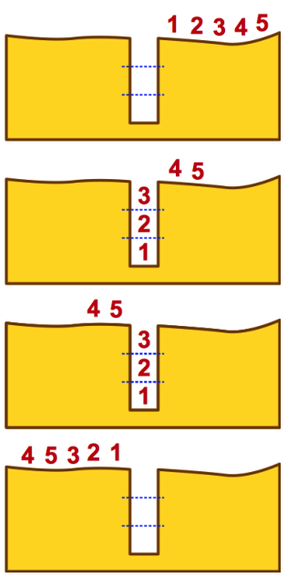
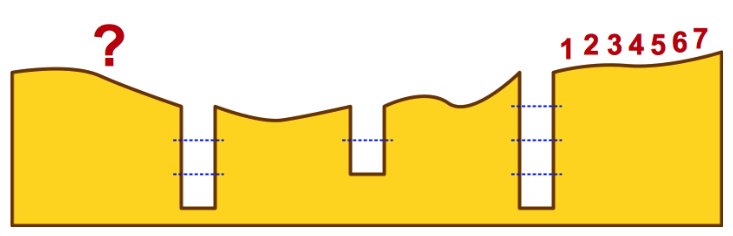

Die Biber gehen häufig in Gruppen durch den dunklen Wald. Im Wald sind die Pfade sehr schmal. Deshalb gehen sie dort immer in einer Reihe, ohne sich zu überholen.

Auf den Pfaden im Wald gibt es viele Gruben. Die Biber überwinden eine Grube so: Zuerst springen so viele Biber in die Grube, wie dort hinein passen. Danach gehen die anderen aus der Gruppe über die volle Grube. Schließlich klettern die Biber in der Grube der Reihe nach aus der Grube hinaus. Dann kann die Gruppe weitergehen.

Die Bilder zeigen, wie 5 Biber eine Grube überwinden. In diese Grube passen 3 Biber hinein.

Eine Gruppe von 7 Bibern geht durch den dunklen Wald. Die Biber müssen drei Gruben überwinden. In die erste Grube passen 4 Biber, in die zweite passen 2 Biber, und in die dritte passen 3 Biber.

**In welcher Reihenfolge gehen die Biber nach der dritten Grube weiter?**
