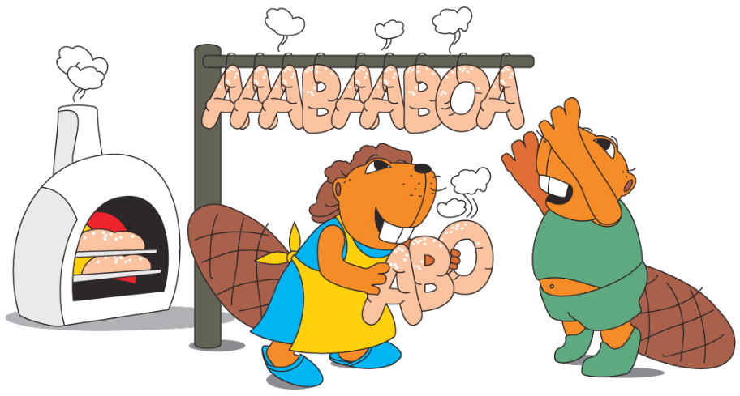

Zwei Biber arbeiten in einer Bäckerei. Susanna ist die Bäckerin. Sie holt immer drei Brezeln gleichzeitig aus dem Ofen und hängt sie von rechts an die Stange: zuerst eine A-Brezel, dann eine B-Brezel und zum Schluss eine O-Brezel. Peter ist der Verkäufer. Er verkauft immer die Brezel, die ganz rechts an der Stange hängt. Susanna backt schneller als Peter die Brezeln verkaufen kann.

**Wie viele Brezeln hat Peter mindestens verkauft, wenn die Stange wie im Bild behängt ist?**
