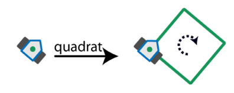
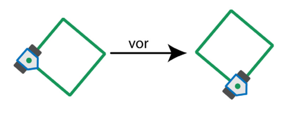
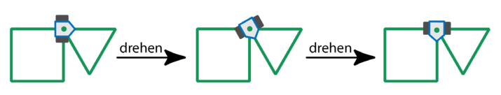
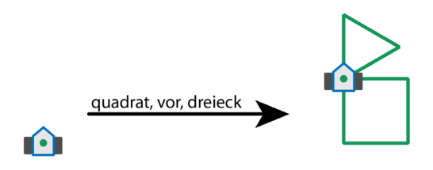
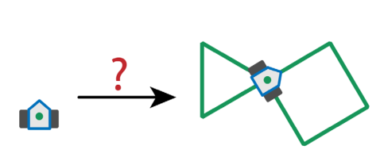

Der Roboter Drawbot kann fahren und dabei zeichnen! Man kann Drawbot die folgenden Befehle eingeben: **quadrat, dreieck, vor, drehen**

Die Wirkung der Befehle ist so:

**quadrat:** Drawbot zeichnet ein Quadrat. An den Ecken dreht er sich nach rechts.

**dreieck:** Drawbot zeichnet ein Dreieck. An den Ecken dreht er sich nach rechts.

**vor:** Drawbot fährt auf einer vorher gezeichneten Linie bis zur nächsten Ecke.

**drehen:** Drawbot dreht sich nach rechts bis zur nächsten gezeichneten Linie.

Man kann Drawbot auch eine Folge von Befehlen eingeben. Ein Beispiel: quadrat, vor, dreieck. Die Wirkung dieser Befehlsfolge ist so:

**Welche Befehlsfolge hat diese Wirkung?**
