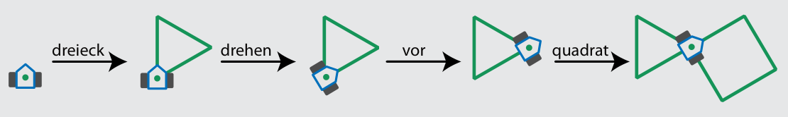
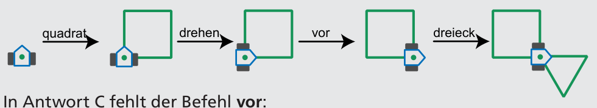
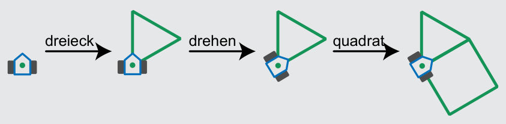
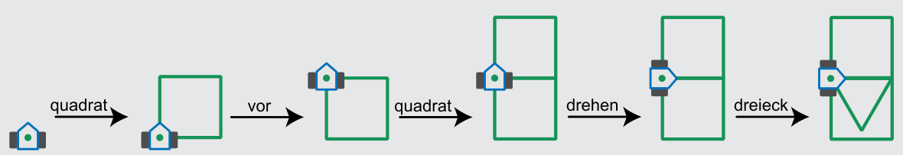

Antwort B ist richtig:

In Antwort A sind die Befehle dreieck und quadrat vertauscht:

In Antwort C fehlt der Befehl vor:

Antwort D ist offensichtlich falsch; die Wirkung dieser Befehlsfolge enthält zwei Quadrate.

## Das ist Informatik!

Die einfachsten Bausteine von Programmen für Roboter (und auch für Computer) sind Befehle und Folgen von Befehlen. Weil echte Roboter meistens nicht zeichnen, sondern Autos zusammenbauen oder bei medizinischen Therapien helfen, kennen sie viel mehr und deutlich kompliziertere Befehle als der Drawbot. Und ihre Befehle haben eine starke Wirkung. Da ist es wichtig, dass ihre Programmierer sehr genau arbeiten.

Mit den einfachen Zeichenbefehlen von Drawbot kann man aber gut Programmieren lernen. Solche Befehle wurden zuerst von dem amerikanischen Informatiker Seymour Papert in der Sprache Logo eingeführt. In Logo zeichnet eine kleine Schildkröte, die „Turtle“. Turtle-Grafik gibt es heute in vielen Programmiersprachen, zum Beispiel Python.
