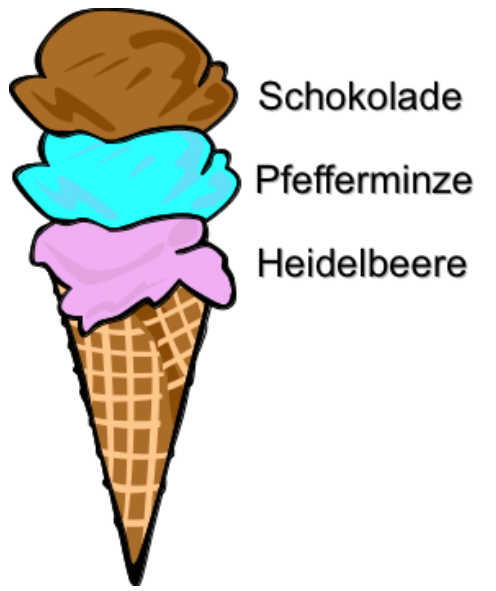

Beim Eissalon LIFO werden die gewünschten Eiscreme-Kugeln auf eine Eistüte gestapelt. Und zwar genau in der Reihenfolge, wie es der Kunde sagt.

**Was muss der Kunde sagen, wenn er eine Eistüte haben will, wie hier gezeigt?** Ich hätte gerne eine Eistüte mit ...
