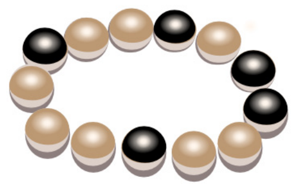

Beim letzten Wasserfest trug die Biberprinzessin dieses magische Armband aus hellen und dunklen Perlen. Danach hat sie es geöffnet und in ein Kästchen gelegt.

Nun braucht sie ihr magisches Armband wieder und schaut in das Kästchen. Oje: Jemand hat drei falsche Armbänder dazu gelegt.

**Welches der vier Armbänder ist ihr magisches Armband?**
