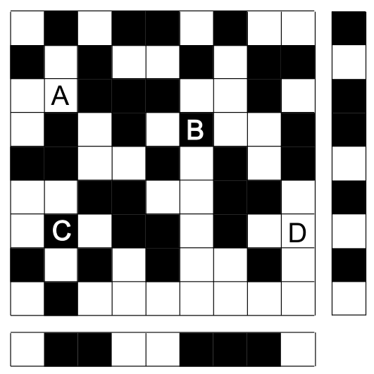

Der Platz vor dem Computer-Clubhaus soll einen neuen Belag aus 9 mal 9 schwarzen und weißen Kacheln bekommen. Ein Designer entwirft den Plan. Er fügt dem Plan rechts und unten je einen Streifen von Kontrollfeldern hinzu.

Wenn die Anzahl der schwarzen Kacheln in einer Zeile gerade ist, dann ist das Kontrollfeld rechts daneben schwarz. Sonst ist es weiß.

Wenn die Anzahl der schwarzen Kacheln in einer Spalte gerade ist, dann ist das Kontrollfeld darunter schwarz. Sonst ist es weiß.

Leider hat sich ein Fehler eingeschlichen. Die Kontrollfelder sind in Ordnung, aber eine Kachel ist falsch.

**Welche Kachel ist falsch?**
