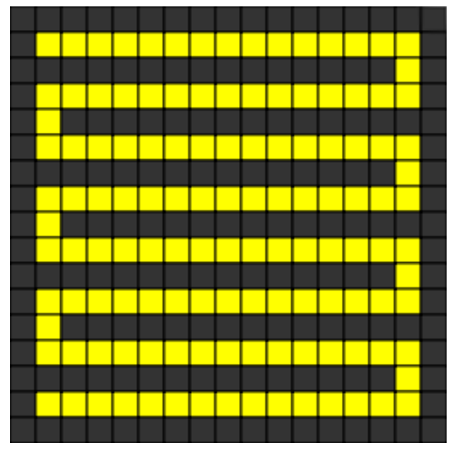

Im Keller der Biberburg lebt ein Monster. Es versteckt sich irgendwo in den gelben Zellen. Wo graue Wände sind, kann das Monster nicht sein.

Du willst das Monster fangen. Im Computer-Spiel klickt man auf eine gelbe Zelle, und die gelben Zellen werden weniger. Dann klickt man wieder auf eine gelbe Zelle, und so weiter. Wenn nur noch eine gelbe Zelle übrig ist, hat man das Monster darin gefangen.

**Wie viele Klicks braucht man mindestens, um das Monster in jedem Fall zu fangen?**
