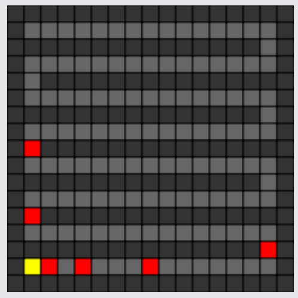

Die 127 gelben Zellen bilden eine lange Reihe. Die beste Fang-Strategie ist es, immer auf die mittlere gelbe Zelle zu klicken. Nach dem ersten Klick bleiben dann 63 Zellen übrig. Nach dem zweiten Klick bleiben 31, dann 15, 7 und 3 Zellen übrig. Nach dem sechsten Klick bleibt nur eine gelbe Zelle übrig.

Mit weniger als 6 Klicks kann man das Monster nicht fangen.

## Das ist Informatik!

Bei jedem Trennschritt den Suchbereich zu halbieren, nennt die Informatik „Binäres Suchen“. Binäres Suchen ist möglich, wenn man genau weiß, wo im Suchraum die Mitte ist. Programme können das leicht berechnen. Binäres Suchen ist möglich, wenn die Objekte im Suchraum passend geordnet sind, zum Beispiel als Liste oder als balancierter Binärbaum. Bei dieser Biber-Aufgabe stellt die Nachbarschaftsbeziehung der Kellerzellen die Ordnung her.

Menschen „halbieren“ in zwei ungleiche Teile, wenn sie zum Beispiel im Lexikon einen Begriff oder in einem Buch eine bestimmte Seitennummer suchen – falls diese Bücher noch aus Papier sind. Hier ist es eine menschliche Strategie, bei jedem Trennschritt möglichst nahe an die gesuchte Stelle zu kommen. Man weiß ja ungefähr, wo das „D“ im Lexikon oder die Seite 550 in einem 600-seitigen Schmöker positioniert ist.
