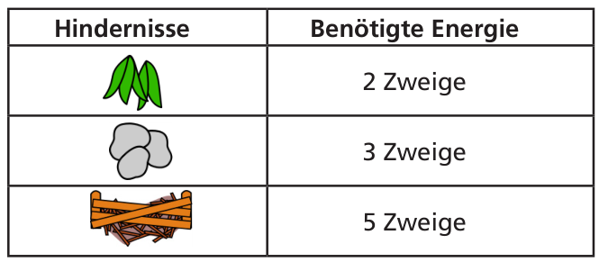
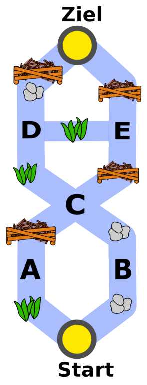

Um zu seinem Ziel zu kommen, muss der Biber einen passenden Weg durch das Flusssystem nehmen. Auf seinem Weg muss er Hindernisse überwinden. Dabei verbraucht der Biber folgende Mengen an Energie:

Um genug Energie zu haben, isst der Biber vor dem Start 15 Zweige. Im abgebildeten Flusssystem siehst du die Hindernisse. A, B, C, D und E sind die Zwischenstationen auf den möglichen Wegen.

**Welchen der folgenden Wege wird der Biber nehmen? Beachte, dass er vor dem Start nur 15 Zweige gegessen hat.**
