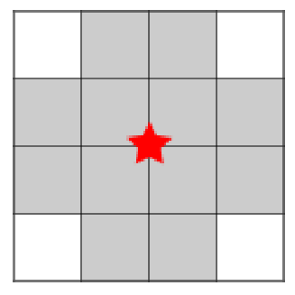
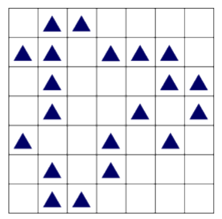

In einem Dorf wird ein Funknetz mit mehreren Funkmasten eingerichtet. Es soll den Einwohnern Zugang zum Internet bieten.

Jeder Funkmast hat ein begrenztes Sende- und Empfangsgebiet. Das ist im Bild zu sehen: Nur auf den zwölf umliegenden Grundstücken (grau) erhält ein Haus Verbindung zum Funkmast in der Mitte (roter Stern).

Ein Funkmast kann immer nur auf dem Schnittpunkt zweier Grundstücksgrenzen aufgestellt werden. Die Sende- und Empfangsgebiete von Funkmasten dürfen sich überlappen.

Das Bild zeigt die Karte des Dorfes. Jedes Dreieck kennzeichnet ein Haus.

**Wie viele Funkmasten müssen mindestens aufgestellt werden, damit alle Häuser eine Verbindung zum Funknetz erhalten?**
