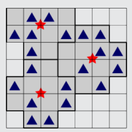
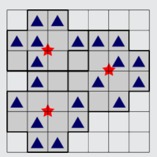

3 ist richtig: Mit nur zwei Funkmasten kann man nicht alle Häuser mit dem Funknetz verbinden. Zwei verschiedene Aufstellungen von je drei Funkmasten würden allen Häusern eine Verbindung zum Funknetz ermöglichen:

 

## Das ist Informatik!

Die Informatik kennt Algorithmen, große Flächen durch kleine Flächen unterschiedlicher Formen kostengünstig und mehr oder weniger genau abzudecken. Beispiele sind das Zuschneiden von Stoffen in der Bekleidungsindustrie oder das Ausstanzen von Blechteilen im Maschinenbau. Auch die Planung von Funknetzen für Mobilfunk, für digitales terrestrisches Radio und Fernsehen oder für WLAN ist von diesem Problemtyp. Algorithmen, die für alle Abdeckungsprobleme immer die besten Lösungen finden, sind aber häufig unpraktikabel. Bei größeren Problemen würde die Rechenzeit viel zu lange dauern. Die Informatik entwickelt für größere Abdeckungsprobleme Algorithmen, die zwar nicht immer die besten, aber immerhin verlässlich gute Lösungen finden – und insbesondere sehr schnell sind.
