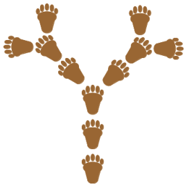

Fußstapfen-Bäume! Die werden nach einem bestimmten Schema gestapft.

Dies ist das Stapfprogramm für einen **1-Baum**:

1. Gehe 1 Schritt vor, dabei machst du 1 Fußstapfen.
2. Gehe wieder zurück.

Kennt man das Stapfprogramm für einen 1-Baum, sieht das Stapfprogramm für einen **2-Baum** so aus:

1. Gehe 2 Schritte vor, dabei machst du 2 Fußstapfen.
2. Wende dich nach rechts und stapfe einen 1-Baum.
3. Wende dich nach links und stapfe einen 1-Baum.
4. Gehe in deiner Spur wieder zurück.

Das Stapfprogramm für einen **3-Baum** ist nun auch schnell erklärt, denn ein 3-Baum enthält 2-Bäume:

1. Gehe 3 Schritte vor, dabei machst du 3 Fußstapfen.
2. Wende dich nach rechts und stapfe einen 2-Baum.
3. Wende dich nach links und stapfe einen 2-Baum.
4. Gehe in deiner Spur wieder zurück.

Das Stapfprogramm für einen 4-Baum folgt dem gleichen Schema.

**Welcher Baum ist nach diesem Schema ein 4-Baum?**
