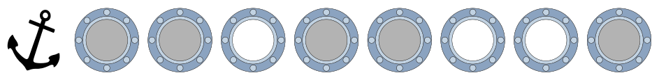
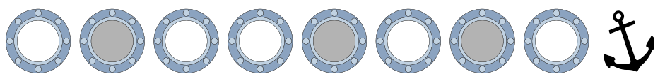
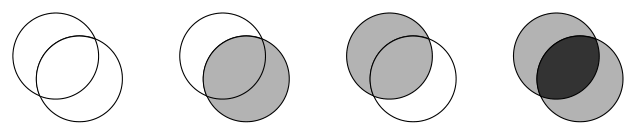

Kapitän Schwarz lässt an seiner Yacht die Gläser der Bullaugen erneuern. Jedes neue Glas ist entweder ganz klar oder getönt. Der Glasermeister bekommt folgenden Auftrag:

Bullaugen auf der linken Seite:

Bullaugen auf der rechten Seite:

Da sich immer zwei Bullaugen genau gegenüber liegen, kann man von jeder Seite durch die Yacht hindurch sehen. Je nach Tönung der Gläser ist die Durchsicht ganz klar, getönt oder stark getönt (weiß, grau, dunkelgrau):

**Klicke auf die Bullaugen.** Ändere die Durchsichten so, dass sie dem Auftrag des Glasermeisters entsprechen. Tipp: Achte auf die Position der Anker.
