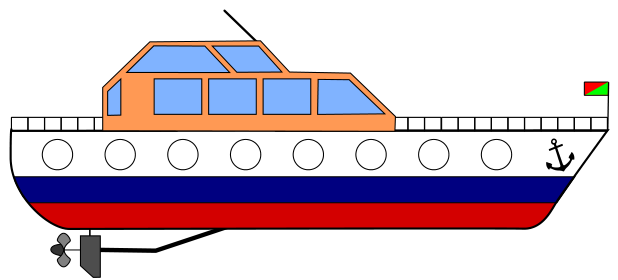

Kapitän Schwarz lässt an seiner Yacht die Gläser der Bullaugen erneuern. Jedes neue Glas ist entweder ganz klar oder getönt. Der Glasermeister bekommt folgenden Auftrag:

Bullaugen auf der linken Seite:

Bullaugen auf der rechten Seite:

Da sich immer zwei Bullaugen genau gegenüber liegen, kann man von jeder Seite durch die Yacht hindurch sehen. Je nach Tönung der Gläser ist die Durchsicht ganz klar, getönt oder stark getönt (weiß, grau, dunkelgrau):

Die Yacht hat den Anker auf der rechten Seite:

**Stelle die acht Durchsichten so ein, dass sie dem Auftrag des Glasermeisters entsprechen. Die Durchsichten sind so angeordnet, wie man sie auf der Yacht mit dem Anker rechts sieht. Tipp: Achte auf die Position der Anker.**
