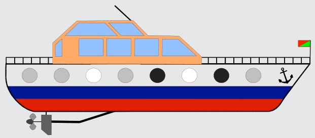

Zuerst müssen wir klären, welche der Bullaugen sich gegenüber liegen. Dafür nutzen wir den Anker als Anhaltspunkt. Wenn wir jetzt durch die Bullaugen-Paare blicken, ergeben sich folgende Durchsichten:

## Das ist Informatik!

Die Darstellung von Information ist ein wichtiger Aspekt in der Informatik.

In dieser Biber-Aufgabe wird eine Addition (genauer eigentlich eine Vektoraddition – es kann ja nie zu einem Übertrag kommen) durch Überdeckungen der Tönungen von Fenstergläsern motiviert. Dabei steht ein klares Fensterglas für 0, ein schwach getöntes für 1 und ein stark getöntes für 2.

Um die Addition einfach durchführen zu können, muss man allerdings vorab die zu addierenden Elemente (Fenstergläser) zusammenführen. Dazu ist es wichtig zu erkennen, dass hier eine Fensterreihe in spiegelverkehrter Form vorliegt.
