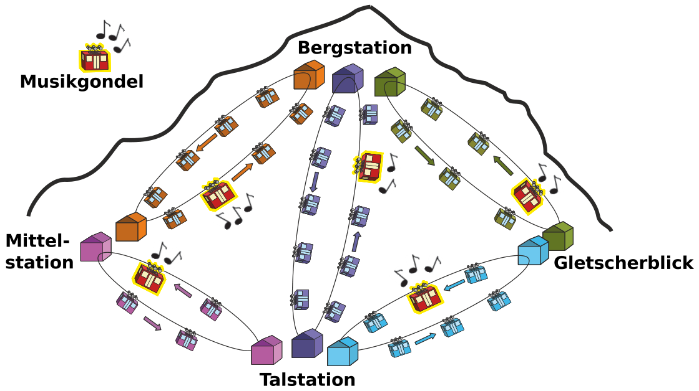
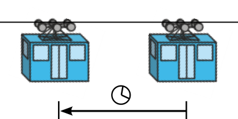

Tom möchte zur Bergstation fahren. Er kann von der Talstation aus mit verschiedenen Gondelbahnen dorthin gelangen. Aber er möchte nur in Gondeln fahren, in denen Musik gespielt wird. Das Bild zeigt die aktuellen Positionen der Gondeln zu dem Zeitpunkt, als Tom von der Talstation wegfahren möchte.

Alle Gondelbahnen bewegen sich gegen den Uhrzeigersinn. Der Fahrzeitabstand von einer Gondel zur vorigen Gondel ist die Zeit, welche die Gondel braucht, um von ihrer aktuellen Position zur aktuellen Position der vorigen Gondel zu fahren (siehe Bild).

Der Fahrzeitabstand ist bei allen Gondelbahnen gleich. Er ändert sich auch nicht, wenn Gondeln durch Stationen fahren. Die Gondeln aller Gondelbahnen fahren immer zu gleichen Zeitpunkten durch die Stationen. Wenn Tom durch eine Station fährt, kann er flink und ohne Zeitverlust in die Gondel einer anderen Gondelbahn umsteigen. Manchmal muss er aber auch auf die nächste Musikgondel warten.

**Auf welchem Weg kommt Tom am schnellsten zur Bergstation?**
