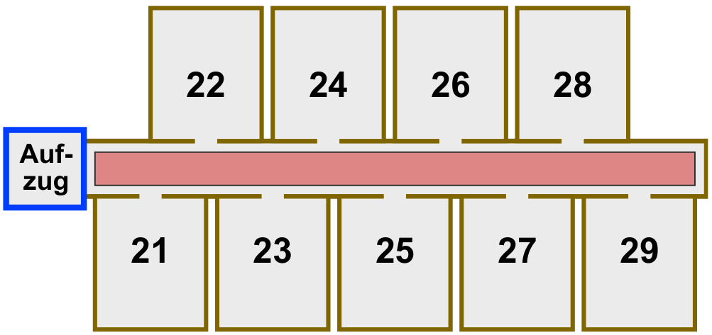

Im Hotel Comfort sind die Zimmernummern zweistellig:

- Die erste Ziffer gibt das Stockwerk an, in welchem das Zimmer liegt.
- Die zweite Ziffer gibt an, wie weit das Zimmer vom Aufzug entfernt ist. Die Zimmer sind also in jedem Stockwerk so angeordnet wie hier für den zweiten Stock gezeigt:

Die Gäste im Hotel Comfort sollen sich nur wenig anstrengen. Je näher ein Zimmer am Aufzug ist, desto komfortabler liegt es. Sind zwei Zimmer in verschiedenen Stockwerken gleich weit vom Aufzug entfernt, liegt das Zimmer im niedrigeren Stockwerk komfortabler. Zimmer 32 liegt also komfortabler als Zimmer 15, und Zimmer 22 liegt komfortabler als Zimmer 32.

Im Hotel Comfort gilt die Vorschrift: Ein neuer Gast bekommt stets dasjenige freie Zimmer, das am komfortabelsten liegt.

Folgende zehn Zimmer sind derzeit frei: **12, 25, 11, 43, 22, 15, 18, 31, 44, 52**

Nun kommen nach und nach zehn neue Gäste.

**In welcher Reihenfolge müssen die freien Zimmer vergeben werden?**
