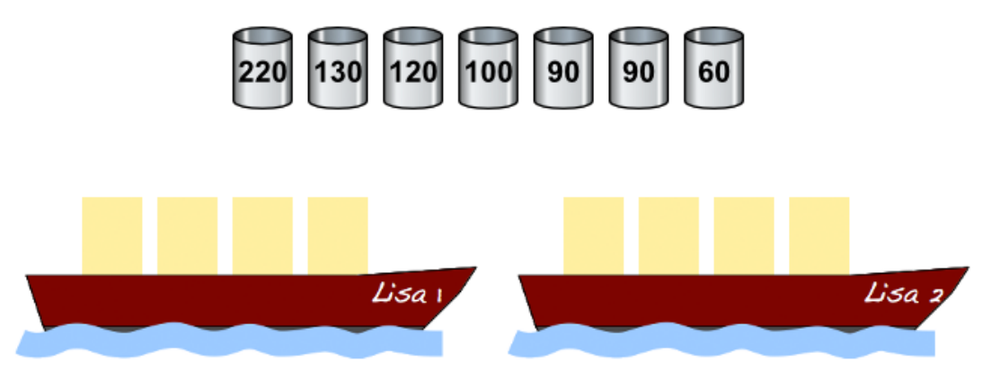

Falke und Folke, den beiden Fischern, gehören die Boote „Lisa 1“ und „Lisa 2“ – die beiden Lisas. Jedes der Boote kann mit höchstens 300 Kilogramm beladen werden. Falke und Folke sollen mit den beiden Lisas einige Fässer mit verschiedenen Sorten Fisch transportieren. Die Fischer werden nach dem transportierten Gewicht bezahlt.

Über den Booten siehst du die Fässer, die zur Verfügung stehen. Jedes Fass ist mit seinem Gewicht (in Kilogramm) beschriftet. Du kannst jedes Boot mit höchstens 300 Kilogramm beladen.

**Belade die beiden Lisas mit so viel Kilogramm Fisch wie möglich! Weise dazu jedem Fass ein Boot zu (oder lass es am Hafen).**
