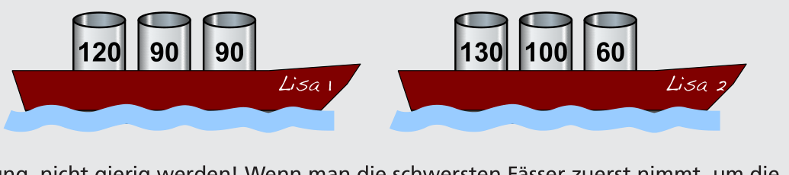

Insgesamt können die Boote mit 590 Kilogramm Fisch beladen werden: 120+90+90=300 Kilogramm auf dem einen Boot, 130+100+60=290 Kilogramm auf dem anderen. Welches der beiden Boote welche Fässer trägt, ist egal.

Achtung, nicht gierig werden! Wenn man die schwersten Fässer zuerst nimmt, um die beiden Lisas zu beladen, kann man die Boote höchstens mit 220+60=280 Kilogramm bzw. 130+120=250 Kilogramm beladen. Das macht nur 530 Kilogramm insgesamt. Mit mehr als 590 Kilogramm können die Lisas nicht beladen werden. Denn dazu müssten beide Boote mit 300 Kilogramm beladen werden. Es gibt aber nur eine Möglichkeit, Fässer zu einem Gesamtgewicht von 300 Kilogramm zu kombinieren, nämlich 120+90+90=300 Kilogramm.

## Das ist Informatik!

Viele Menschen sind fasziniert davon, Dinge zu optimieren – häufig übrigens, um Kosten zu sparen und ihren Profit zu maximieren. Bei nicht ganz einfachen Problemen werden meist Computerprogramme zum Optimieren verwendet: um kürzeste Routen, optimale Beladungen, ideale Stundenpläne usw. zu finden.

Manche Optimierungsprobleme lassen sich mit einem „gierigen“ (engl.: greedy) Algorithmus lösen. Dabei wird jeder Schritt zur Lösung (hier: die Auswahl eines Fasses) so gewählt, dass er so viel Profit (hier: so viel Gewicht) wie möglich bringt – das ist gierig.

Das Schöne an der Informatik: In den meisten Fällen hilft Gier nicht weiter, und komplexere Algorithmen werden benötigt, um optimale Lösungen zu finden. Für einige Probleme lässt sich sogar nachweisen, dass diejenigen Algorithmen, die garantiert optimale Lösungen finden, selbst von Computern nur mit unvertretbar hohem Aufwand ausgeführt werden können. Für viele solcher schwierigen Optimierungsprobleme hat die Informatik effiziente Algorithmen entwickelt, die zwar keine optimalen Lösungen, aber nachweisbar sehr gute, fast optimale Lösungen finden.
