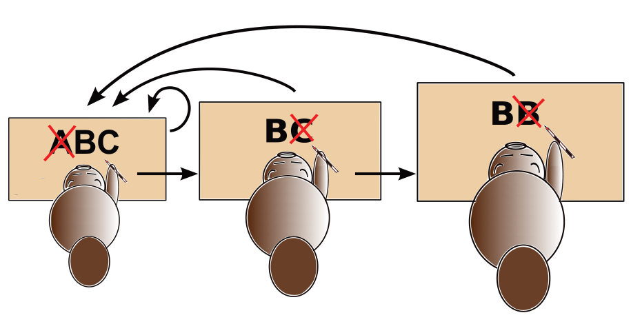

Im weit entfernten Bibirien werden die – ohnehin nur aus den Buchstaben A, B und C bestehenden – Zeitungsmeldungen gelegentlich vom Nachrichtenamt „korrigiert“. Die drei Korrektoren des Amtes lesen eine Nachricht jeweils von links nach rechts und suchen dabei nach bestimmten Buchstabenmustern:

1. Der **Unterkorrektor** sucht nach der Folge **ABC**. Wenn er die Folge findet, ersetzt er sie durch **BC** und fängt mit der geänderten Nachricht wieder von vorne an. Findet er die Folge nicht, gibt er die Nachricht an den Hauptkorrektor weiter.
2. Der **Hauptkorrektor** sucht nach der Folge **BC**. Wenn er die Folge findet, ersetzt er sie durch **B** und gibt die geänderte Nachricht an den Unterkorrektor zurück. Findet er die Folge nicht, gibt er die Nachricht an den Chefkorrektor weiter.
3. Der **Chefkorrektor** sucht nach der Folge **BB**. Wenn er die Folge findet, ersetzt er sie durch **B** und gibt die geänderte Nachricht an den Unterkorrektor zurück. Findet er die Folge nicht, ist die Korrektur zu Ende.

Drei der folgenden Nachrichten bestehen am Ende der Korrektur nur noch aus einem Buchstaben B. Nur eine **nicht**.

**Welche?**
