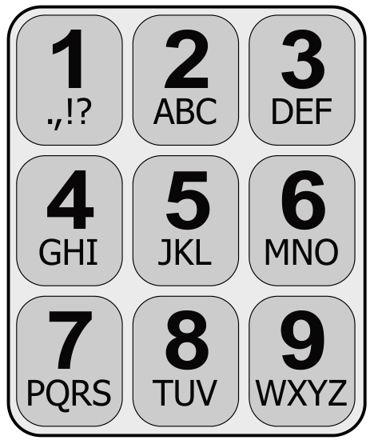

Daniel schreibt auf seinem alten Handy Nachrichten. Für jeden Buchstaben muss er die passende Taste einmal, zweimal, dreimal oder viermal tippen. Danach kommt eine kurze Pause.

Für das Zeichen „C“ tippt er zum Beispiel dreimal die Taste mit der Ziffer 2, denn C ist der dritte Buchstabe auf dieser Taste. Für das Wort GUT tippt er insgesamt vier Mal: einmal die 4, zweimal die 8, einmal die 8.

Daniel tippt sechs Mal, um den Namen einer Freundin zu schreiben.

**Welches ist der Name der Freundin?**
