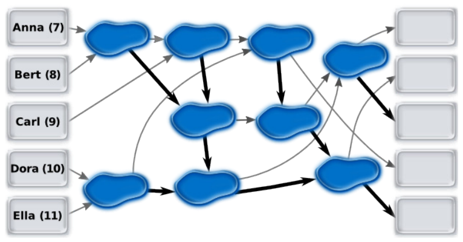

Anna (7 Jahre), Bert (8 Jahre), Carl (9 Jahre), Dora (10 Jahre) und Ella (11 Jahre) spielen ein Spiel, bei dem sie von Pfütze zu Pfütze springen. Dazu haben sie Pfeile auf den Boden gemalt.

Am Anfang stehen die Kinder auf den Feldern links und springen entlang der Pfeile jeweils zu einer Pfütze. Ein Kind, das zuerst in einer Pfütze ist, wartet, bis ein zweites dazu kommt. Das ältere Kind springt dann weiter entlang des dicken Pfeiles, das jüngere entlang des dünnen Pfeiles.

**Ordne jedem Kind das Feld rechts zu, auf dem es am Ende ankommt.** Die fünf Felder rechts sind von oben nach unten durchnummeriert.
