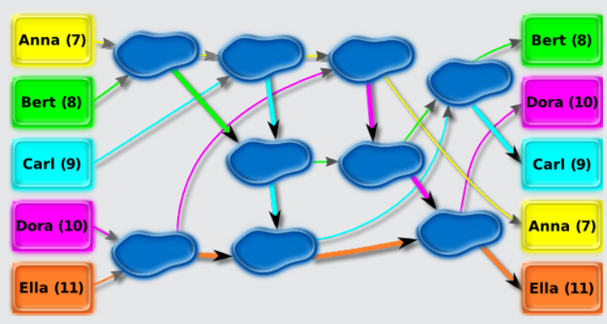
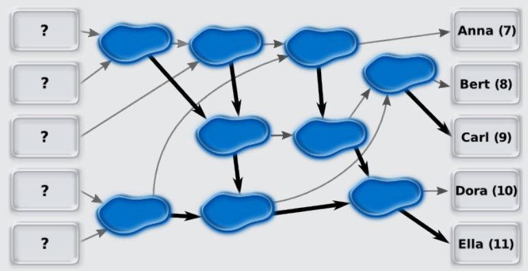

Das folgende Bild zeigt die Wege der fünf Kinder.

Von oben nach unten kommen am Ende an: Bert, Dora, Carl, Anna, Ella.

## Das ist Informatik!

Die Pfützen und Pfeile bilden ein Netzwerk. Die Pfützen funktionieren wie Vergleichselemente. Wären die Vergleichselemente richtig verbunden, könnte das Netzwerk die fünf Kinder nach ihrem Alter sortieren. Es wäre ein Sortiernetz.

Das Netz in dieser Biber-Aufgabe ist kein Sortiernetz. Aber diese Grafik zeigt ein Sortiernetz – mit den richtigen Verbindungen:

