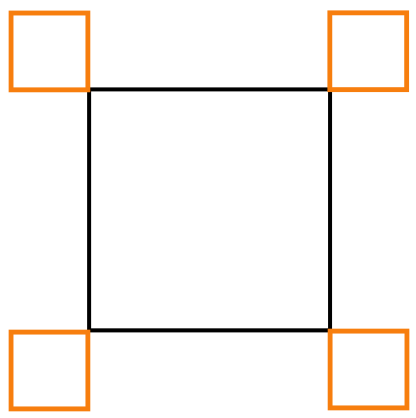

Ein Roboter ist darauf spezialisiert, Rechtecke zu zeichnen. Er kann die folgenden einfachen Anweisungen ausführen:

| Anweisung | Wirkung |
|---|---|
| `Orange` | zeichne eine orange Linie der Länge 1 |
| `Black` | zeichne eine schwarze Linie der Länge 1 |
| `Turn` | drehe dich um 90° im Uhrzeigersinn |

Außerdem kann der Roboter die folgenden Anweisungen ausführen, die aus anderen Anweisungen A und B zusammengesetzt werden; A und B selbst können einfache oder zusammengesetzte Anweisungen sein:

| Anweisung | Wirkung |
|---|---|
| `A, B` | führe A aus und führe danach B aus |
| `n×(B)` | führe B n-mal aus |

Der Roboter soll die folgende Zeichnung erstellen.

**Welche Anweisung ergibt NICHT die gewünschte Zeichnung?**
