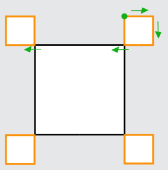
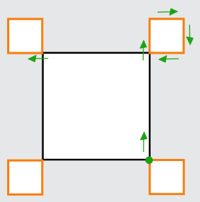
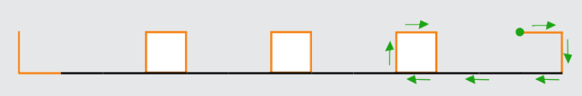
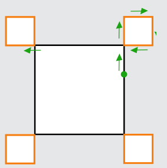

Antwort C ist richtig:

Die Anweisung A ergibt die gewünschte Zeichnung:

Die Anweisung B ergibt die gewünschte Zeichnung:

Die Anweisung C ergibt **nicht** die gewünschte Zeichnung:

Die Anweisung D ergibt die gewünschte Zeichnung:

## Das ist Informatik!

Selbst wenn man eine sehr einfache Programmiersprache wie die des Rechteck-Roboters verwendet, kann man leicht Fehler machen. Fehler in Programmen heißen in der Informatik „Bugs“, und „Debugging“ bezeichnet die Suche nach Fehlern in einem Programm. Im Jahr 2014 wurde der „Heartbleed Bug“ bekannt. Es handelte sich um einen Fehler in einer weit verbreiteten Programmbibliothek für verschlüsselten Datenaustausch. Dieser Fehler machte Angriffe auf viele Internet-Dienste möglich, zum Beispiel zum Stehlen von Zugangsdaten (Benutzernamen und Passwörtern). Bugs können also weitreichende Auswirkungen haben.

Debugging gehört – neben dem systematischen Vermeiden von Fehlern – zu den ganz besonders wichtigen Arbeiten in der Informatik.
