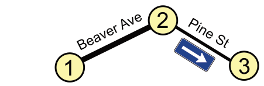
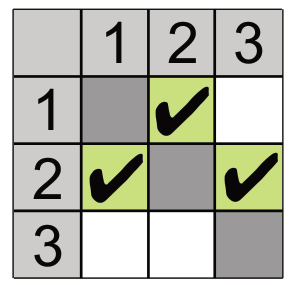

In Beaver Springs wurde neulich die Pine Street zur Einbahnstraße gemacht. Nun muss Jack, der einzige Taxifahrer in der Gegend, sich neu merken, wie er von einem Ort zum anderen kommt. Für die drei Knotenpunkte 1, 2 und 3 legt Jack die folgende Tabelle an. Er setzt Häkchen in einige Felder der Tabelle, um sich zu merken, in welche Richtungen er welche Straßen befahren darf.

Auch im Nachbarort Beavertown wurden einige Straßen zu Einbahnstraßen gemacht.

Jack braucht also auch für Beavertown eine Tabelle mit Häkchen. Die Tabelle hat fünf Zeilen (A bis E von oben nach unten) und fünf Spalten (A bis E von links nach rechts). Ein Häkchen in Zeile X und Spalte Y bedeutet: Jack darf von X nach Y fahren. Die Felder auf der Diagonale (von A nach A usw.) sind gesperrt.

**Setze die Häkchen in die richtigen Felder! Tippe dazu auf die Felder (grün = Häkchen).**
