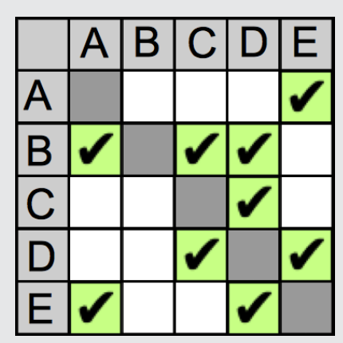

Ein Häkchen im Tabellenfeld in Zeile X und Spalte Y (kurz: im Feld (X,Y)) bedeutet, dass Jack vom Knotenpunkt X zum Knotenpunkt Y fahren kann. Für eine in beiden Richtungen befahrbare Straße wie Mulberry Alley zwischen den Knotenpunkten D und E müssen also zwei Häkchen gesetzt werden: eines ins Feld (D,E) und eines ins Feld (E,D). Verläuft zwischen zwei Knotenpunkten eine Einbahnstraße, wie etwa die Plum Lane von B nach C, darf nur ein Häkchen gesetzt werden, in diesem Fall ins Feld (B,C).

## Das ist Informatik!

Die ausgefüllte Tabelle sagt genau, von welchem Knotenpunkt man direkt zu welchem anderen fahren darf. Gleichzeitig sagt sie aber nichts über besondere Eigenschaften der Verbindung zwischen zwei Knotenpunkten.

Ein Taxifahrer würde über eine Verbindung vermutlich auch gerne wissen, wie schnell gefahren werden kann, wie wahrscheinlich ein Stau ist, ob der Straßenbelag gut in Schuss ist usw. Aber um zu entscheiden, ob man überhaupt von A nach B gelangt, evtl. auch über mehrere Verbindungen, genügt die durch die Häkchen in der Tabelle gegebene Information. Informatiksysteme (und Menschen wohl auch) verarbeiten meist nur die Informationen, die für die gewünschte Funktion nötig sind. Sie verwenden ein abstraktes Modell der Wirklichkeit.
