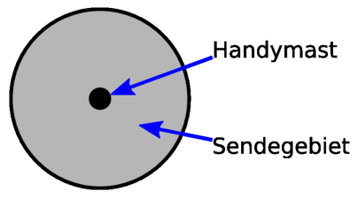

Auf einer sturmumbrausten Insel sollen Handymasten aufgestellt werden. Jeder Handymast deckt ein kreisförmiges Sendegebiet ab.

Wenn sich ihre Sendegebiete überlappen, dann sind zwei Handymasten direkt über Funk verbunden. Ein Handymast kann mit einem anderen auch indirekt verbunden sein; über eine Kette direkt miteinander verbundener Handymasten.

Wegen des ständigen Sturmes sollen die Handymasten so aufgestellt werden, dass der Ausfall eines einzelnen Handymastes verkraftet werden kann. Fällt ein Handymast aus, dann sollen alle anderen trotzdem noch immer verbunden sein.

**Wie müssen die Handymasten aufgestellt werden?**
