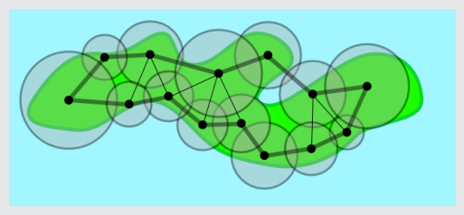
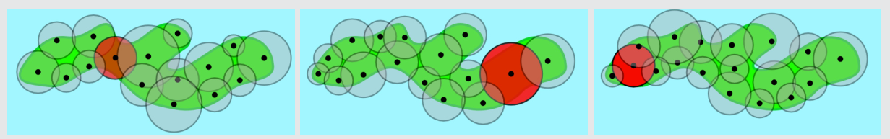

Antwort B ist richtig:

Zeichnet man die direkten Verbindungen der Handymasten in den Plan B, dann entsteht unter anderem auch eine ringförmige Verbindung aller Handymasten (dicker Linienzug). Entfernt man einen beliebigen Handymast, dann bleiben alle übrigen trotzdem noch immer miteinander verbunden.

Bei den anderen Plänen gibt es einen solchen Verbindungsring nicht, sondern einen kritischen Handymast (rotes Sendegebiet). Wenn der ausfällt, verbleiben zwei nicht miteinander verbundene Gruppen von Handymasten.

## Das ist Informatik!

Bei technischen Systemen können Komponenten ausfallen. Das mobile Telefonieren ist so ein technisches System, die Funkmasten sind Komponenten davon, aber noch vieles andere mehr. Fällt eine Komponente aus, kann das unterschiedlich schwere Folgen haben. Das ganze System könnte schlagartig ausfallen. Oder nur bestimmte Funktionen des Systems könnten ausfallen, während alles andere weiter funktioniert. Oder alles funktioniert normal weiter.

Der Grad der Ausfallsicherheit hängt davon ab, wie stark die Komponenten des Systems aufeinander angewiesen sind und für welche besonders wichtigen Komponenten Ersatz-Komponenten eingebaut sind, die bei Ausfällen einspringen.

Die Informatik ist vor allem zuständig für die Software-Komponenten in technischen Systemen. Wenn eine Software-Komponente einen Programmierfehler enthält oder mit unzulässigen Eingaben „gefüttert“ wird, kann sie falsche Ausgaben produzieren oder ganz „abstürzen“.

Da nutzt es nichts, dem technischen System einen Ersatz-Computer mit derselben fehlerhaften Software hinzuzufügen. Wenn ein technisches System besonders ausfallsicher sein soll, dann muss die Ersatz-Software von einem anderen Team ein zweites Mal geplant und in einer anderen Sprache programmiert werden (diversitäre Redundanz).
