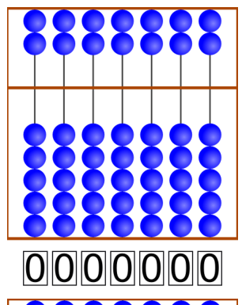
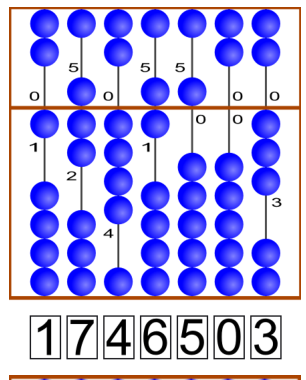
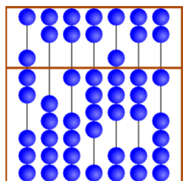

Der „Suanpan“ ist ein traditionelles chinesisches Rechenbrett. Mit seinen Kugeln kann man Zahlen einstellen. Dazu stellt man an den Stangen die einzelnen Ziffern der gewünschten Zahl ein.

Im oberen Feld hat jede Kugel den Wert „5“. Im unteren Feld hat jede Kugel den Wert „1“. Sind an einer Stange alle Kugeln von der Mittellinie weggeschoben, dann ist die eingestellte Ziffer die „0“.

Will man eine andere Ziffer einstellen, dann schiebt man die notwendigen Kugeln zur Mittellinie. Im Beispiel sind an den Stangen die Ziffern 1, 7, 4, 6, 5, 0 und 3 eingestellt. Insgesamt ist also die Zahl 1746503 eingestellt.

Hier siehst du einen weiteren Suanpan:

**Welche Zahl ist hier eingestellt?**
