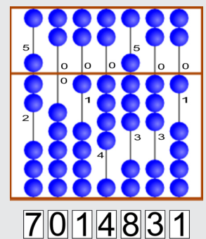

Die richtige Zahl ist: 7014831

## Das ist Informatik!

Seit tausenden von Jahren benutzen die Menschen Hilfsmittel, um sich große Zahlen zu merken und damit zu rechnen. In dieser Biber-Aufgabe wird der Suanpan vorgestellt, eine chinesische Variante des bekannten Abakus. Suanpans sind schon lange Zeit in Gebrauch, und für viele Menschen sind sie bis heute noch ein regelmäßiges Hilfsmittel. Der Suanpan wurde zusammen mit seiner Rechenmethode Zhusuan im Jahr 2013 in die „Repräsentative Liste des immateriellen Kulturerbes der Menschheit“ der UNESCO aufgenommen.
