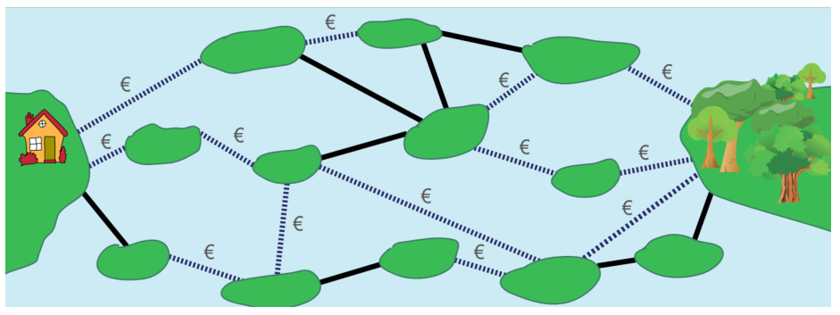

Die Inseln im See sind über öffentliche und private Brücken verbunden. Über eine private Brücke (gestrichelte Linie) zu gehen kostet eine Gebühr. Über eine öffentliche Brücke (durchgezogene Linie) zu gehen kostet nichts.

Sandy möchte von ihrem Haus zum Wald gehen. Sandy sucht einen Weg mit möglichst wenigen Brücken. Aber sie ist knapp bei Kasse und kann sich nur Wege mit höchstens zwei privaten Brücken leisten.

Finde unter den Wegen mit höchstens zwei privaten Brücken den mit den insgesamt wenigsten Brücken.

**Wie viele Brücken hat dieser Weg?**
