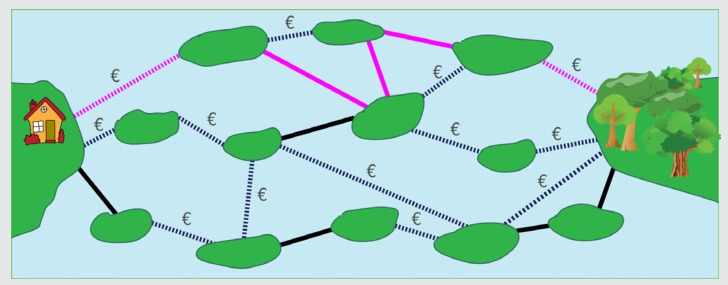

5 ist richtig:

Es gibt keinen Weg von Sandys Haus zum Wald mit weniger als vier Brücken. Alle Wege mit vier Brücken enthalten drei oder mehr private Brücken; diese Wege kann Sandy sich nicht leisten. Das Bild zeigt einen Weg mit fünf Brücken, von denen zwei privat sind. Das ist der kürzeste Weg, den Sandy sich leisten kann.

## Das ist Informatik!

Brücken zwischen Inseln, Straßen zwischen Orten, Netzwerkverbindungen zwischen Computern, Leiterbahnen zwischen den Lötstellen einer Platine: Es gibt viele, verschiedene Lebensbereiche, in denen Objekte untereinander auf irgendeine Art und Weise verbunden sind. Um Systeme zu entwickeln, die in solchen Bereichen nützlich sind, greift die Informatik gerne auf ein Modell aus der Mathematik zurück: den Graph. Als Ursprung der Graphentheorie gilt die Arbeit des Schweizer Universalgenies Leonhard Euler über das „Königsberger Brückenproblem“. Euler zeigte im Jahr 1736, dass es einen Rundweg über die damals existierenden Brücken der Stadt Königsberg (das heutige Kaliningrad) nicht geben kann.
